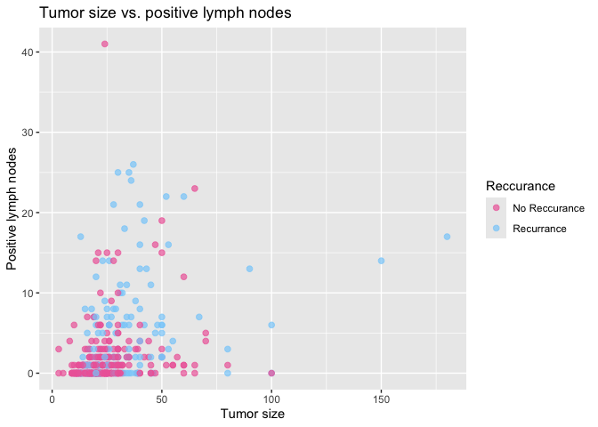
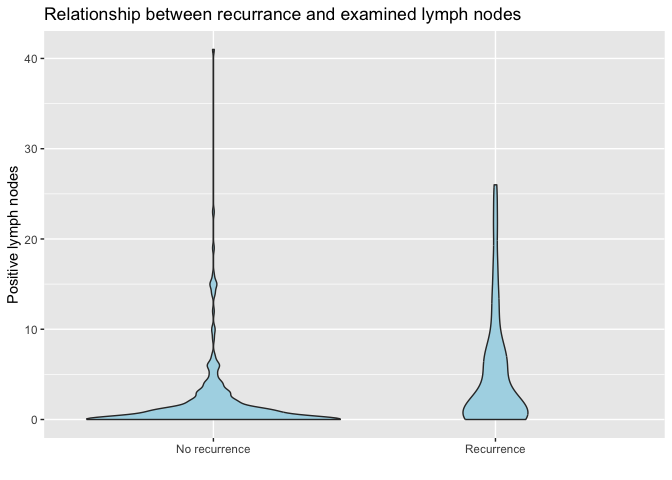
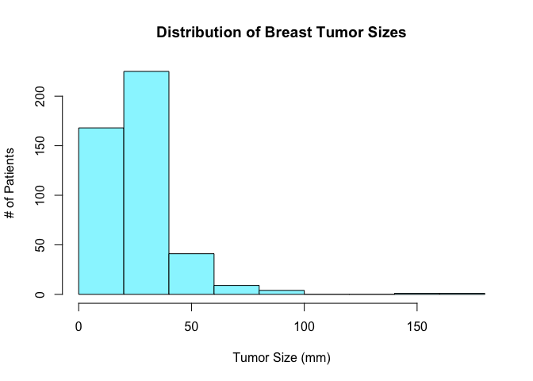
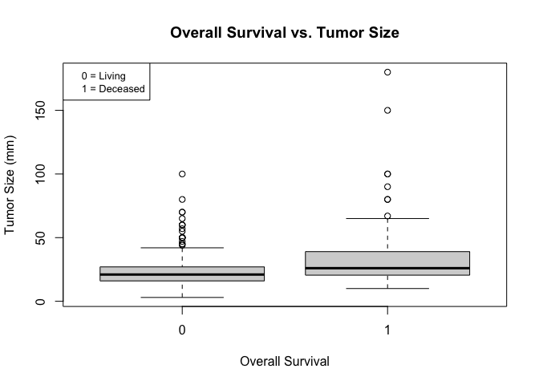
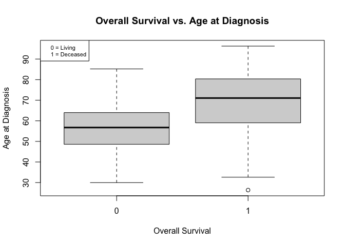

**ABSTRACT** 

## 1. ABSTRACT
Breast cancer is a very complex disease with multiple variables that contribute to the recurrence of such cancer as well as mortality from the disease.
In this project, our primary goal is to determine whether the likelihood of breast cancer recurrence and mortality can be predicted using a patient's
genetic profile and clinical data. The current visual analysis using scatter plots, histograms, and box plots suggest that it is feasible to predict
breast recurrence and mortality with the genetic and clinical data.

## 2. Introduction
For our project, we want to focus on the the question: using a patient’s genetic and clinical profile, can we predict the likelihood of breast cancer 
recurrence or mortality? We’ll be centering our research around specific genetic factors such as tumor mutational burden and clinical data such as tumor 
size, estrogen receptor status, and age at diagnosis. Our goal is to extract the data, perform various statistical procedures such as logistic regression
to classify whether a patient is likely to experience a recurrence of breast cancer or death, similar to an actual medical research center.

## 3. Executive Summary
  * So far, we have found that ???
* **Data: Where did you source the data, What variable/observations are included, Summaries of the variables, Cleaning**
  * We sourced the data from cbioportal.org's targeted sequencing of primary breast tumors. After cleaning it up, our data set is 449 observations of 9 different variables. 
  * After cleaning up the data set, we decided on 9 variables to help answer our question. The variables and their significance are:
    * **ER_STATUS**: Whether or not the tumor cells have estrogen. These types of tumors respond best to hormonal therapy and generally have a better outlook for treatment
    * **GRADE**: The abnormality of the tumor under a microscope, a higher grade indicates faster growth and faster spread
    * **TMB_NONSYNONYMOUS**: Stands for tumor mutation burden and is a count of how many protein-changing mutations the tumor has 
    * **TUMOR_SIZE**: The size of the tumor at the time of diagnosis in mm
    * **AGE_AT_DIAGNOSIS**: The age of the patient at the time of diagnosis
    * **LYMPH_NODES_EXAMINED_POSITIVE**: The number of nearby lymph nodes that contained cancer, a higher number indicates that the cancer has spread 
    * **OS_BOOL**: Stands for overall survival status and is for if the patient has died. 0 means that the patient is living and 1 means that the patient has passed away
    * **RFS_BOOL**: Stands for recurrence-free survival status and is for if the cancer came back. 0 means that there was no recurrence and 1 means that there was a recurrence
    * **Recurrence**: Whether or not there was a recurrence of the cancer
    
    
##4. Visualization:
```{r}

```

Our scatter plot of 'Tumor size vs. positive lymph nodes' with the data points differentiated by if there was recurrence or not suggest that recurrence is typically indicated by a larger tumor size and more positive lymph nodes.
  
```{r}

```

Moreover, the box plot 'Positive lymph nodes by recurrence' suggest that 'No recurrence' has a smaller cluster of positive lymph nodes compared to 'Recurrence' that has a much larger cluster of positive lymph nodes. This box plot suggests that the larger the number of positive lymph nodes, the more likely there is to be a recurrence of the cancer.

```{r}
knitr::include_graphics("Project-Visualizations_files/figure-gfm/unnamed-chunk-3-1.png")
```

```{r}

```

```{r}

```

From the box plot, the median tumor size for deceased patients is larger than the median tumor size for living patients. THE IQR for the deceased group, starts
at a higher tumor size and is much larger than the IQR for the living group. We also observe that the biggest outliers for tumor size lay in the deceased group.
This suggests that it would be feasible to use tumor size to predict whether a patient is likely to experience death.

```{r}

```

From the box plot, the median age for the deceased group is around 70 years while the median age for the living group is a little below 60 years. The IQR for the deceased group is at a higher position
in the graph compared to the IQR for the living group. This suggest that age of diagnosis is feasible for use in predicting whether a patient is likely to experience death.

* **Analysis: Provide some preliminary plans of what analysis you aim to complete. Mention models, tests, procedures, and some ideas of what expected outcomes you hope to find.**
  * We plan to use ?? models to better answer our question
* **Future work: Describe what is left to do and what is your plan**
  * We need to further analyze the results and flesh out the accuracy and cases of false positives, false negatives, etc.
  * The visuals here provide an associate, so we plan on using a regression model to test how well the variables predict recurrence. 

* **Contributions**
  * Member 1 - Sri
    * Worked on the writing that explained our project details and created visuals ('Tumor size vs. positive lymph nodes' and 'Positive lymph nodes by recurrence') that could help describe the relationship between several variables. The scatter plots could serve as supporting visuals for why there may or may not be relationships between the variables and will be further analyzed with models to better understand what the scatter plots could indicate. Defined the variables being used in the project and their significance to understanding our topic.
  * Member 2 did this []
  * Member 3 did this []


**BE SURE TO INCLUDE THIS IN THE FINAL PROJECT AS WELL**: 
• Data: What is the data available for performing the analysis? Where did you retrieve these data from?
What are the variables and number of observations available? What steps where performed to clean
the data? If the data is obtained via randomized simulations, clarify the data generating procedure.
• Visualization: Provide preliminary visualizations in the form of histograms, density plots, scatter
plots, box-plots, and numerical summaries of the data, depending on the type of analysis.