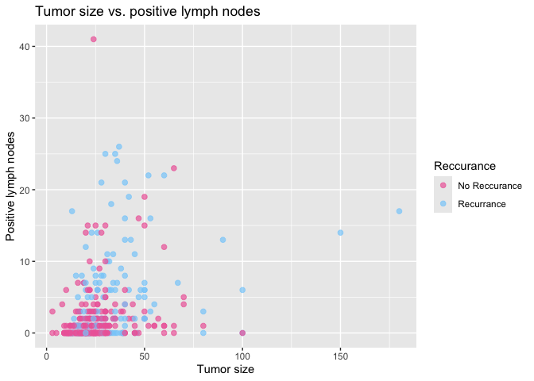
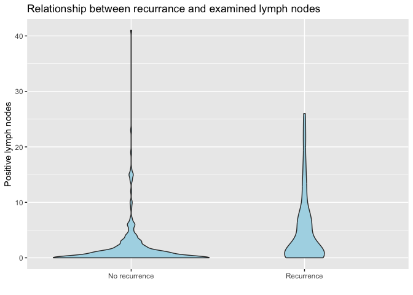
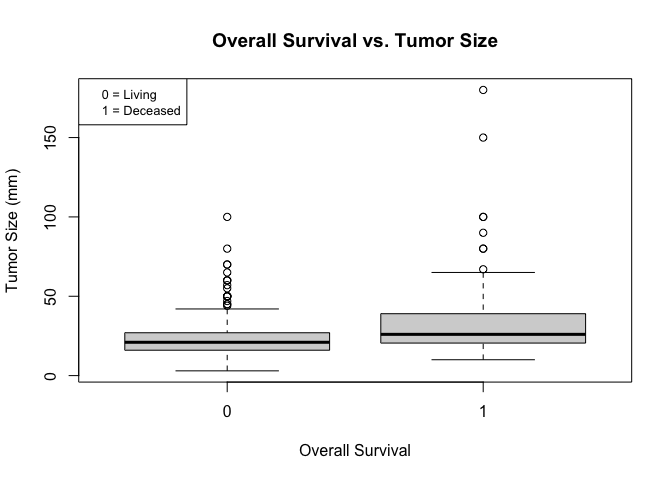
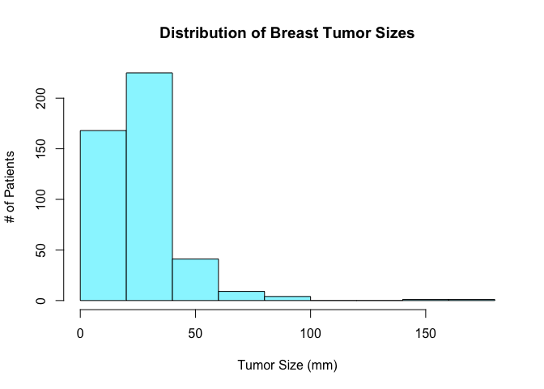
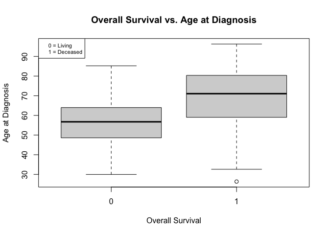

Project Visualizations
================

An additional R Markdown file with visualizations, with appropriate
interpretation of findings.

## Tumor size vs. positive lymph nodes, colored by recurrence

``` r
library(tidyverse)
```

    ## ── Attaching core tidyverse packages ──────────────────────── tidyverse 2.0.0 ──
    ## ✔ dplyr     1.2.1     ✔ readr     2.1.6
    ## ✔ forcats   1.0.1     ✔ stringr   1.5.2
    ## ✔ ggplot2   4.0.1     ✔ tibble    3.3.0
    ## ✔ lubridate 1.9.5     ✔ tidyr     1.3.2
    ## ✔ purrr     1.2.2     
    ## ── Conflicts ────────────────────────────────────────── tidyverse_conflicts() ──
    ## ✖ dplyr::filter() masks stats::filter()
    ## ✖ dplyr::lag()    masks stats::lag()
    ## ℹ Use the conflicted package (<http://conflicted.r-lib.org/>) to force all conflicts to become errors

``` r
cleaned_df <- read_csv("cleaned_clinical_data.csv") %>%
  mutate(Reccurance = factor(RFS_BOOL, levels = c(0,1),
                             labels = c("No Reccurance", "Recurrance")))
```

    ## Rows: 449 Columns: 8
    ## ── Column specification ────────────────────────────────────────────────────────
    ## Delimiter: ","
    ## chr (1): ER_STATUS
    ## dbl (7): GRADE, TMB_NONSYNONYMOUS, TUMOR_SIZE, AGE_AT_DIAGNOSIS, LYMPH_NODES...
    ## 
    ## ℹ Use `spec()` to retrieve the full column specification for this data.
    ## ℹ Specify the column types or set `show_col_types = FALSE` to quiet this message.

``` r
ggplot(cleaned_df, aes(TUMOR_SIZE, LYMPH_NODES_EXAMINED_POSITIVE, color = Reccurance)) +
  geom_point(size = 2, alpha = 0.7) + scale_color_manual(values = c("hotpink2", "lightskyblue")) +
  labs(title = "Tumor size (mm) vs. positive lymph nodes",
       x = "Tumor size",
       y = "Positive lymph nodes")
```

<!-- -->

``` r
ggplot(cleaned_df, aes(x = factor(RFS_BOOL, labels = c("No recurrence", "Recurrence")),
                       y = LYMPH_NODES_EXAMINED_POSITIVE)) +
  geom_boxplot() +
  labs(title = "Positive lymph nodes by recurrence",
       x = "", y = "Positive lymph nodes")
```

<!-- -->

Our scatter plot of ‘Tumor size vs. positive lymph nodes’ with the data
points colored by recurrence suggest that recurrence tends to occur in
patients with larger tumor sizes and more positive lymph nodes.
Moreover, the box plot ‘Positive lymph nodes by recurrence’ shows that
patients with no recurrence had a few to no positive lymph nodes while
patients who did have recurrence had much higher counts and a larger
spread across the boxplot. This suggests that the more positive lymph
nodes that a patient has, the more likely that cancer is to reoccur. A
possible explanation is that positive lymph nodes indicate that the
cancer had already spread beyond the original tumor. Once spread, it’s a
lot harder to contain which helps explain the high likeliness of cancer.

``` r
# histograms

hist(cleaned_df$AGE_AT_DIAGNOSIS, main = "Distribution of Age at Breast Cancer Diagnosis", xlab = "Age at Diagnosis (Years)", ylab = "# of Patients", breaks = seq(20,100, by = 5), col = "cadetblue")
```

<!-- -->

``` r
hist(cleaned_df$TUMOR_SIZE, main = "Distribution of Breast Tumor Sizes", xlab = "Tumor Size (mm)", ylab = "# of Patients", col = "cadetblue1")
```

<!-- -->

``` r
boxplot(TUMOR_SIZE ~ OS_BOOL, 
        data = cleaned_df,
        main = "Overall Survival vs. Tumor Size",
        xlab = "Overall Survival",
        ylab = "Tumor Size (mm)")
legend("topleft", c("0 = Living", "1 = Deceased"), cex = 0.8)
```

<!-- -->
From the boxplot, the median tumor size for deceased patients is larger
than the median tumor size for living patients. THE IQR for the deceased
group, starts at a higher tumor size and is much larger than the IQR for
the living group. We also obsevre that the biggest outliers for tumor
size lay in the deceased group.

``` r
boxplot(AGE_AT_DIAGNOSIS ~ OS_BOOL, 
        data = cleaned_df,
        main = "Overall Survival vs. Age at Diagnosis",
        xlab = "Overall Survival",
        ylab = "Age at Diagnosis")
legend("topleft", c("0 = Living", "1 = Deceased"), cex = 0.7)
```

<!-- -->
From the boxplot, the median age for the deceased group is around 70
years while the median age for the living group is a little below 60
years. The IQR for the deceased group is at a higher position in the
graph compared to the IQR for the living group.
